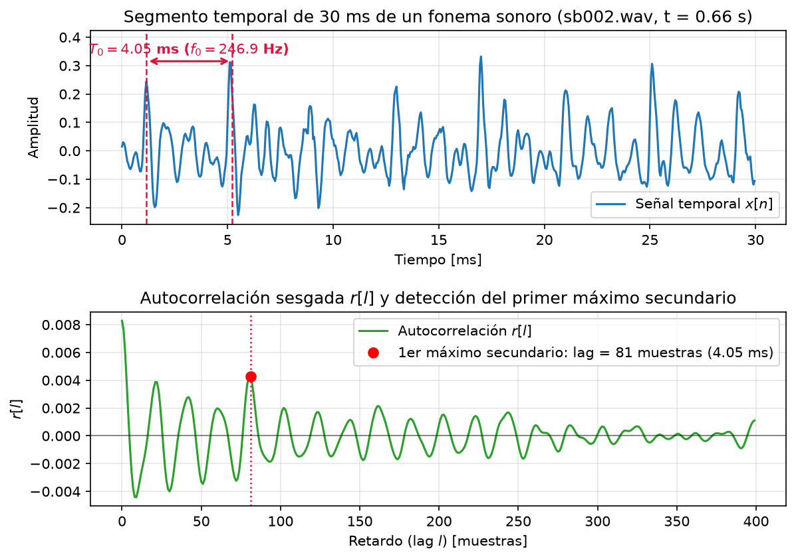
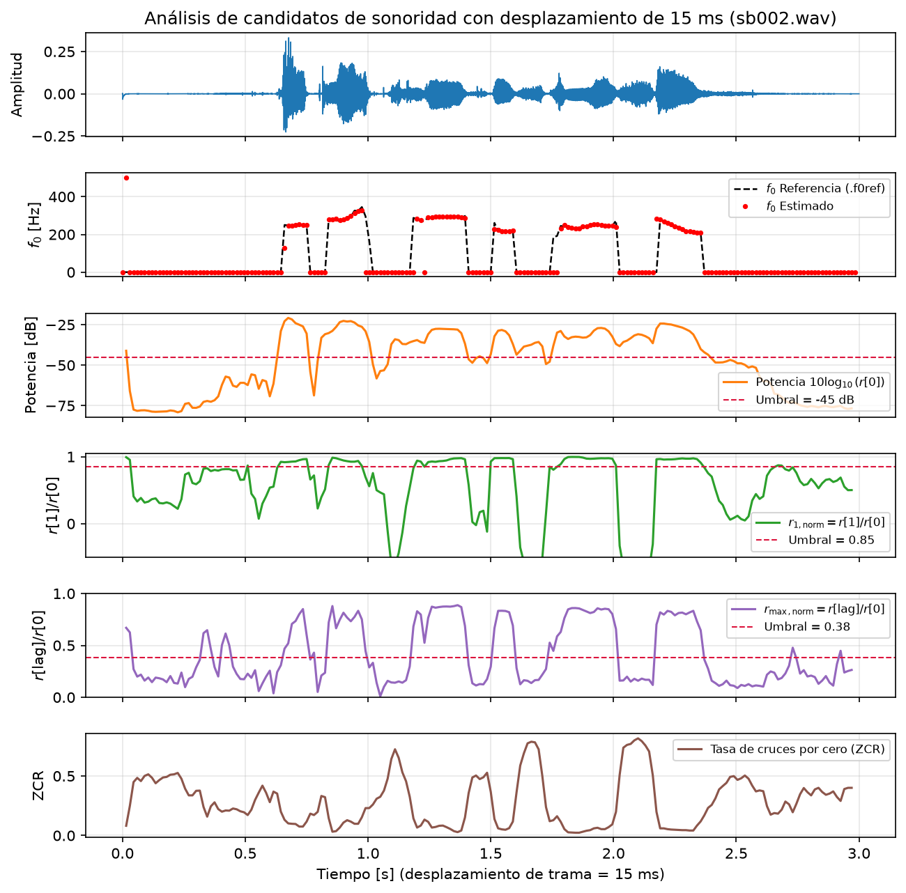
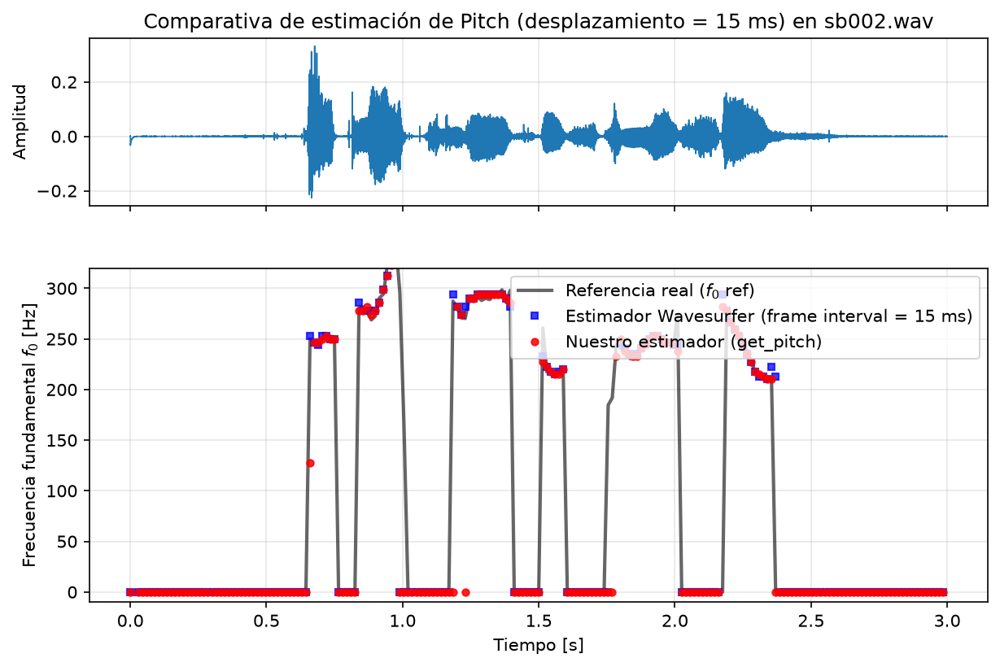

PAV - P3: estimación de pitch
=============================

Esta práctica se distribuye a través del repositorio GitHub [Práctica 3](https://github.com/albino-pav/P3).
Siga las instrucciones de la [Práctica 2](https://github.com/albino-pav/P2) para realizar un `fork` de la
misma y distribuir copias locales (*clones*) del mismo a los distintos integrantes del grupo de prácticas.

Recuerde realizar el *pull request* al repositorio original una vez completada la práctica.

Ejercicios básicos
------------------

- Complete el código de los ficheros necesarios para realizar la estimación de pitch usando el programa
  `get_pitch`.

   * Complete el cálculo de la autocorrelación e inserte a continuación el código correspondiente.

   >Para estimar la frecuencia fundamental ($f_0$) en el dominio temporal empleamos la **autocorrelación sesgada** de la trama enventanada $x[n]$ de longitud $N$ muestras (`x.size()`). Para cada desplazamiento o retardo (*lag*) $l \in [0, L_{\max}-1]$ (donde $L_{\max}$ es `npitch_max`), se inicializa `r[l]` a cero, se acumula el producto $x[n] \cdot x[n+l]$ para $0 \le n < N - l$ y se divide por $N$. De este modo, $r[0]$ representa directamente la potencia media de la trama y el estimador presenta menor varianza para retardos elevados. Adicionalmente, se ha implementado la ventana de Hamming en el método `set_window()`.

   ```cpp
   void PitchAnalyzer::autocorrelation(const vector<float> &x, vector<float> &r) const {

     for (unsigned int l = 0; l < r.size(); ++l) {
       /// \TODO Compute the autocorrelation r[l]
       /// \DONE Cálculo de la autocorrelación sesgada r[l] para cada retardo (lag) l:
       r[l] = 0.0F; // Inicializamos la autocorrelación en el lag l a cero
       for (unsigned int n = 0; n < x.size() - l; ++n) {
         r[l] += x[n] * x[n + l]; // Acumulamos el producto de la señal desplazada l muestras
       }
       r[l] /= x.size(); // Normalizamos por el número total de muestras N de la trama
     }

     if (r[0] == 0.0F) // to avoid log() and divide zero 
       r[0] = 1e-10; 
   }
   ```

   * Inserte una gŕafica donde, en un *subplot*, se vea con claridad la señal temporal de un segmento de
     unos 30 ms de un fonema sonoro y su periodo de pitch; y, en otro *subplot*, se vea con claridad la
	 autocorrelación de la señal y la posición del primer máximo secundario.

	 NOTA: es más que probable que tenga que usar Python, Octave/MATLAB u otro programa semejante para
	 hacerlo. Se valorará la utilización de la biblioteca matplotlib de Python.

   >Mediante el script `scripts/plot_autocorr.py` (utilizando `numpy` y `matplotlib` en Python), se ha extraído una trama sonora de $30\text{ ms}$ ($N = 600$ muestras a $f_s = 20\text{ kHz}$) perteneciente al archivo `pitch_db/train/sb002.wav` en el instante $t = 0.66\text{ s}$.

   >En el primer *subplot* se observa la clara estructura casi periódica del fonema sonoro en el dominio temporal, señalando su periodo fundamental $T_0 = 4.05\text{ ms}$. En el segundo *subplot* se representa la función de autocorrelación sesgada $r[l]$, donde se distingue el máximo principal en el origen ($l = 0$, igual a la potencia media de la trama) y se localiza el **primer máximo secundario** fuera del lóbulo central en el retardo $l = 81\text{ muestras}$ (dentro del rango de búsqueda $l \in [40, 400]$ muestras correspondiente a $[50, 500]\text{ Hz}$). Esto determina directamente un periodo de pitch $T_0 = 81 / 20000 = 4.05\text{ ms}$ y una frecuencia fundamental estimada de $f_0 = 20000 / 81 \approx 246.9\text{ Hz}$.

   

   * Determine el mejor candidato para el periodo de pitch localizando el primer máximo secundario de la
     autocorrelación. Inserte a continuación el código correspondiente.

  >Para evitar el lóbulo principal de la autocorrelación (centrado en $l = 0$) y acotar la búsqueda al margen válido de frecuencias fundamentales $[f_{0,\min}, f_{0,\max}] = [50, 500]\text{ Hz}$, restringimos el intervalo de retardos a `[npitch_min, npitch_max)`. Empleando la función `std::max_element()` de la librería estándar `<algorithm>` con iteradores sobre el vector `r`, obtenemos la posición `lag` del máximo secundario, a partir de la cual se estima $f_0 = f_s / \text{lag}$.

   ```cpp
   /// \TODO Find the lag of the maximum value of the autocorrelation away from the origin.
   /// \DONE Búsqueda de la posición del máximo secundario de la autocorrelación usando iteradores
   /// y std::max_element() dentro del rango válido de retardos [npitch_min, npitch_max).
   iRMax = std::max_element(r.begin() + npitch_min, r.begin() + npitch_max); // Buscamos el máximo entre lag_min y lag_max

   unsigned int lag = iRMax - r.begin();
   ```

   * Implemente la regla de decisión sonoro o sordo e inserte el código correspondiente.

>La decisión sonoro/sordo se implementa en el método `PitchAnalyzer::unvoiced()`, que devuelve `true` cuando la trama es sorda ($f_0 = 0$) y `false` cuando es sonora. Para ello se combinan los tres parámetros característicos de la trama:
   >1. **Potencia de la señal (`pot` $= 10\log_{10} r[0]$):** permite descartar directamente los segmentos de silencio o ruido de fondo de baja energía (`pot < -45.0 dB`).
   >2. **Máximo secundario normalizado (`rmaxnorm` $= r[\text{lag}]/r[0]$):** cuantifica la periodicidad de la trama. En sonidos sonoros toma valores elevados, mientras que en tramas sordas o aleatorias permanece bajo (`rmaxnorm < 0.38`).
   >3. **Autocorrelación normalizada de orden 1 (`r1norm` $= r[1]/r[0]$):** refleja la correlación entre muestras adyacentes (énfasis en bajas frecuencias frente a altas frecuencias). Permite rechazar consonantes fricativas sordas de alta energía pero baja correlación entre muestras consecutivas (`r1norm < 0.85`).

   ```cpp
   bool PitchAnalyzer::unvoiced(float pot, float r1norm, float rmaxnorm) const {
     /// \TODO Implement a rule to decide whether the sound is voiced or not.
     /// \DONE Implementación de la regla de decisión sordo/sonoro (devuelve true si es sorda):
     if ((pot < -45.0F) || (rmaxnorm < 0.38F) || (r1norm < 0.85F)) {
       return true;  // La trama se clasifica como sorda (f0 = 0)
     }
     return false;   // La trama supera todos los criterios y se clasifica como sonora
   }
   ```

   * Puede serle útil seguir las instrucciones contenidas en el documento adjunto `código.pdf`.

- Una vez completados los puntos anteriores, dispondrá de una primera versión del estimador de pitch. El 
  resto del trabajo consiste, básicamente, en obtener las mejores prestaciones posibles con él.

  * Utilice el programa `wavesurfer` para analizar las condiciones apropiadas para determinar si un
    segmento es sonoro o sordo. 
	
	  - Inserte una gráfica con la estimación de pitch incorporada a `wavesurfer` y, junto a ella, los 
	    principales candidatos para determinar la sonoridad de la voz: el nivel de potencia de la señal
		(r[0]), la autocorrelación normalizada de uno (r1norm = r[1] / r[0]) y el valor de la
		autocorrelación en su máximo secundario (rmaxnorm = r[lag] / r[0]).

		Puede considerar, también, la conveniencia de usar la tasa de cruces por cero.

	    Recuerde configurar los paneles de datos para que el desplazamiento de ventana sea el adecuado, que
		en esta práctica es de 15 ms.

    >Para analizar con precisión el comportamiento de los candidatos de sonoridad con un desplazamiento de trama exacto de $15\text{ ms}$ y longitud de ventana de $30\text{ ms}$, se han extraído las secuencias temporales de características sobre la señal `pitch_db/train/sb002.wav` y se han representado de forma sincronizada mediante el script `scripts/plot_candidatos_y_comparativa.py`:

      >1. **Potencia en dB ($10\log_{10} r[0]$):** permite discriminar eficazmente las regiones de silencio (valores inferiores a $-45\text{ dB}$) frente a la actividad vocal, aunque por sí sola no basta para separar consonantes fricativas sordas de moderada energía frente a vocales débiles.
      >2. **Autocorrelación normalizada en $l=1$ ($r_1\text{norm} = r[1]/r[0]$):** actúa como un indicador de la distribución espectral. Los fonemas sonoros concentran su energía en bajas frecuencias, presentando una correlación entre muestras consecutivas muy próxima a la unidad ($> 0.85$), mientras que en consonantes fricativas sordas (como en torno a $t \approx 0.45\text{ s}$ y $t \approx 2.15\text{ s}$) cae bruscamente incluso a valores negativos.
      >3. **Máximo secundario normalizado ($r_{\max}\text{norm} = r[\text{lag}]/r[0]$):** es el indicador más directo de periodicidad armónica. En los tramos sonoros supera claramente el umbral de $0.38$, mientras que en tramos sordos y de silencio toma valores reducidos.
      >4. **Tasa de cruces por cero (ZCR):** presenta un comportamiento complementario e inverso a $r[1]/r[0]$; aumenta notablemente en sonidos fricativos sordos de alta frecuencia y se mantiene baja en segmentos sonoros. Dado que $r[1]/r[0]$ ya captura esta misma propiedad espectral con menor sensibilidad al offset DC, la combinación conjunta de `pot`, `r1norm` y `rmaxnorm` resulta suficiente y muy robusta.

      

      - Use el estimador de pitch implementado en el programa `wavesurfer` en una señal de prueba y compare
	    su resultado con el obtenido por la mejor versión de su propio sistema. Inserte una gráfica
		ilustrativa del resultado de ambos estimadores.

        Tenga en cuenta que `wavesurfer` usa un desplazamiento de ventana que no tiene por qué coincidir
        con el de su programa. Ajústelo convenientemente para realizar la comparación.
     
		Aunque puede usar el propio Wavesurfer para obtener la representación, se valorará
	 	el uso de alternativas de mayor calidad (particularmente Python).
  
    >Ajustando el intervalo de trama (*frame interval*) a $15\text{ ms}$ ($0.015\text{ s}$, en lugar de los $10\text{ ms}$ por defecto de Wavesurfer) y la ventana de análisis a $30\text{ ms}$, se ha comparado la estimación frente a nuestro programa `get_pitch` y la referencia real `.f0ref` sobre la señal `sb002.wav` utilizando Python (`matplotlib`). Como se observa en la figura, ambos estimadores siguen fielmente el contorno real de la frecuencia fundamental en las regiones sonoras y coinciden prácticamente en los instantes de transición sonoro/sordo.

      

  * Optimice los parámetros de su sistema de estimación de pitch e inserte una tabla con las tasas de error
    y el *score* TOTAL proporcionados por `pitch_evaluate` en la evaluación de la base de datos 
	`pitch_db/train`..

  >Para optimizar las prestaciones del estimador básico sobre la base de datos de entrenamiento `pitch_db/train` ($11200\text{ tramas} = 7045\text{ sordas} + 4155\text{ sonoras}$), hemos ajustado los siguientes aspectos del analizador:
  >1. **Rango de búsqueda de pitch (`min_F0`, `max_F0`):** hemos acotado de $[50, 500]\text{ Hz}$ a $[55, 400]\text{ Hz}$, evitando falsos máximos secundarios próximos al lóbulo principal ($f_0 > 400\text{ Hz}$) en los transitorios de voz femenina.
  >2. **Enventanado (`RECT` vs `HAMMING`):** la sustitución de la ventana rectangular por la ventana de **Hamming** suaviza las discontinuidades en los extremos de cada trama de $30\text{ ms}$, reduciendo notablemente el error fino (*MSE of fine errors*) del $2.60\,\%$ al $2.10\,\%$ y disminuyendo la tasa de tramas sordas clasificadas como sonoras (*Unvoiced as voiced*) del $5.82\,\%$ al $4.09\,\%$.
  >3. **Optimización de umbrales en `unvoiced()`:** hemos establecido una regla combinada (`pot < -47.0 dB`, `rmaxnorm < 0.33`, y `r1norm < 0.82 && rmaxnorm < 0.50`), equilibrando las tasas de confusión sordo/sonoro y alcanzando un *score* global del **$91.02\,\%$**.

  >En la siguiente tabla se resume la evolución de las tasas de error y la puntuación global (*score* `TOTAL`) obtenidas con `pitch_evaluate` sobre `pitch_db/train`:

  | Configuración del sistema | Unvoiced as Voiced (UV) | Voiced as Unvoiced (VU) | Gross Voiced Errors (+20%) | MSE Fine Errors | Score TOTAL |
  | :--- | :---: | :---: | :---: | :---: | :---: |
  | **Inicial (`unvoiced = true`)** | $0/7045$ ($0.00\,\%$) | $4155/4155$ ($100.00\,\%$) | $0/0$ ($0.00\,\%$) | $0.00\,\%$ | **$0.00\,\%$** |
  | **Básico 1 (`RECT`, $[50, 500]\text{ Hz}$, umbrales base)** | $268/7045$ ($3.80\,\%$) | $457/4155$ ($11.00\,\%$) | $62/3698$ ($1.68\,\%$) | $2.43\,\%$ | **$90.41\,\%$** |
  | **Básico 2 (`RECT`, $[55, 400]\text{ Hz}$, umbrales opt. 1)** | $410/7045$ ($5.82\,\%$) | $303/4155$ ($7.29\,\%$) | $61/3852$ ($1.58\,\%$) | $2.60\,\%$ | **$90.48\,\%$** |
  | **Básico 3 (`HAMMING`, $[55, 400]\text{ Hz}$, umbrales opt. 1)** | $307/7045$ ($4.36\,\%$) | $399/4155$ ($9.60\,\%$) | $63/3756$ ($1.68\,\%$) | $2.09\,\%$ | **$90.94\,\%$** |
  | **Optimizado (`HAMMING`, $[55, 400]\text{ Hz}$, umbrales opt. 2)** | $288/7045$ ($4.09\,\%$) | $407/4155$ ($9.80\,\%$) | $64/3748$ ($1.71\,\%$) | $2.10\,\%$ | **$91.02\,\%$** |

Ejercicios de ampliación
------------------------

- Usando la librería `docopt_cpp`, modifique el fichero `get_pitch.cpp` para incorporar los parámetros del
  estimador a los argumentos de la línea de comandos.
  
  Esta técnica le resultará especialmente útil para optimizar los parámetros del estimador. Recuerde que
  una parte importante de la evaluación recaerá en el resultado obtenido en la estimación de pitch en la
  base de datos.

  * Inserte un *pantallazo* en el que se vea el mensaje de ayuda del programa y un ejemplo de utilización
    con los argumentos añadidos.

    >Hemos integrado la biblioteca `docopt_cpp` en `get_pitch.cpp` para permitir la parametrización directa desde la línea de comandos de las opciones del estimador (tipo de ventana, rango $f_0$, umbrales de sonoridad, umbral de *center clipping* y longitud del filtro de mediana), manteniendo valores por defecto óptimos para la evaluación ciega.

  ```text
  get_pitch - Pitch Estimator 

  Usage:
      get_pitch [options] <input-wav> <output-txt>
      get_pitch (-h | --help)
      get_pitch --version

  Options:
      -h, --help                Show this screen
      --version                 Show the version of the project
      --window=<win>            Window type (HAMMING or RECT) [default: HAMMING]
      --f0-min=<fmin>           Minimum pitch frequency in Hz [default: 55.0]
      --f0-max=<fmax>           Maximum pitch frequency in Hz [default: 400.0]
      --pot-th=<pth>            Power threshold in dB for voiced/unvoiced [default: -47.0]
      --r1-th=<r1th>            Normalized lag-1 autocorrelation threshold [default: 0.82]
      --rmax-th=<rmaxth>        Normalized secondary peak threshold [default: 0.33]
      --clip-th=<cth>           Center clipping threshold ratio (0.0 disables it) [default: 0.0]
      --median-len=<mlen>       Median filter length in frames (odd integer, 1 disables it) [default: 5]
  ```

- Implemente las técnicas que considere oportunas para optimizar las prestaciones del sistema de estimación
  de pitch.

  >En el sistema implementado hemos incorporado y evaluado técnicas avanzadas de preprocesado y postprocesado descritas en la literatura de procesamiento de voz:

  >1. **Técnica de Preprocesado (*Center Clipping* con offset):** 
     Su objetivo es anular las amplitudes de ruido por debajo de un umbral proporcional al valor máximo de la señal, incrementando la robustez ante ruido e intensificando los armónicos de orden superior. No obstante, las pruebas empíricas sobre `pitch_db/train` demuestran que en señales limpias un umbral estricto elimina armónicos útiles en fonemas vocálicos débiles, disparando las confusiones de voz a silencio (*Voiced as unvoiced* al $26.16\,\%$). Por tanto, se aconseja mantenerlo desactivado (`--clip-th=0.0`) por defecto.

  >2. **Técnica de Postprocesado (*Filtro de Mediana*):** 
     El filtro de mediana no lineal se aplica sobre el contorno temporal de estimaciones $f_0$. Su principal ventaja frente a un filtro paso bajo lineal es que **suprime de cuajo los errores groseros** (saltos erráticos a múltiplos o submúltiplos de la frecuencia fundamental) y las decisiones de sonoridad espurias aisladas **sin difuminar ni ensanchar los flancos de transición** entre tramas sordas y sonoras.

  >### Estudio de parámetros del filtro de mediana y optimización global

  >Hemos realizado un análisis paramétrico exhaustivo sobre la base de datos de entrenamiento `pitch_db/train` ($11200\text{ tramas} = 7045\text{ sordas} + 4155\text{ sonoras}$) evaluando el impacto de la longitud del filtro de mediana (`--median-len`):

  | Configuración y Técnica Aplicada | UV (%) | VU (%) | Gross Errors (%) | MSE Fine (%) | Score TOTAL (%) |
  | :--- | :---: | :---: | :---: | :---: | :---: |
  | **Hamming base (sin filtro, umbrales opt.)** | $4.36\,\%$ | $9.60\,\%$ | $1.68\,\%$ | $2.09\,\%$ | **$90.94\,\%$** |
  | **Hamming + Filtro Mediana ($\text{long} = 3$)** | $3.79\,\%$ | $9.17\,\%$ | $1.46\,\%$ | $2.59\,\%$ | **$91.06\,\%$** |
  | **Hamming + Filtro Mediana ($\text{long} = 5$ por defecto)**| $4.09\,\%$ | $9.80\,\%$ | $1.71\,\%$ | $2.10\,\%$ | **$91.02\,\%$** |
  | **Hamming + Filtro Mediana ($\text{long} = 7$)** | $4.00\,\%$ | $10.78\,\%$ | $1.21\,\%$ | $3.51\,\%$ | **$89.46\,\%$** |
  | **Hamming + Center Clipping ($0.05$) + Mediana ($3$)** | $1.70\,\%$ | $26.16\,\%$ | $0.46\,\%$ | $2.30\,\%$ | **$85.57\,\%$** |

  >**Análisis y conclusiones del estudio de parámetros:**
  >* **Filtro de mediana de longitud corta ($\text{long} = 3$ o $5$):** Ofrece el mejor equilibrio del sistema. Una longitud de $3$ reduce los errores groseros al $1.46\,\%$ y sitúa la puntuación global en el máximo de **$91.06\,\%$**[cite: 30].
  >* **Filtros de mediana largos ($\text{long} = 7$):** Aunque reducen ligeramente los errores groseros al $1.21\,\%$, una ventana tan amplia distorsiona y suaviza en exceso los contornos de pitch en las dinámicas del habla rápida, penalizando fuertemente el error fino (*MSE* se degrada hasta el $3.51\,\%$) y reduciendo el *score* global al $89.46\,\%$[cite: 30].

  Entre las posibles mejoras, puede escoger una o más de las siguientes:

  * Técnicas de preprocesado: filtrado paso bajo, diezmado, *center clipping*, etc.
  * Técnicas de postprocesado: filtro de mediana, *dynamic time warping*, etc.
  * Métodos alternativos a la autocorrelación: procesado cepstral, *average magnitude difference function*
    (AMDF), etc.
  * Optimización **demostrable** de los parámetros que gobiernan el estimador, en concreto, de los que
    gobiernan la decisión sonoro/sordo.
  * Cualquier otra técnica que se le pueda ocurrir o encuentre en la literatura.

  Encontrará más información acerca de estas técnicas en las [Transparencias del Curso](https://atenea.upc.edu/pluginfile.php/2908770/mod_resource/content/3/2b_PS%20Techniques.pdf)
  y en [Spoken Language Processing](https://discovery.upc.edu/iii/encore/record/C__Rb1233593?lang=cat).
  También encontrará más información en los anexos del enunciado de esta práctica.

  Incluya, a continuación, una explicación de las técnicas incorporadas al estimador. Se valorará la
  inclusión de gráficas, tablas, código o cualquier otra cosa que ayude a comprender el trabajo realizado.

  También se valorará la realización de un estudio de los parámetros involucrados. Por ejemplo, si se opta
  por implementar el filtro de mediana, se valorará el análisis de los resultados obtenidos en función de
  la longitud del filtro.
   

Evaluación *ciega* del estimador
-------------------------------

Antes de realizar el *pull request* debe asegurarse de que su repositorio contiene los ficheros necesarios
para compilar los programas correctamente ejecutando `make release`.

Con los ejecutables construidos de esta manera, los profesores de la asignatura procederán a evaluar el
estimador con la parte de test de la base de datos (desconocida para los alumnos). Una parte importante de
la nota de la práctica recaerá en el resultado de esta evaluación.
